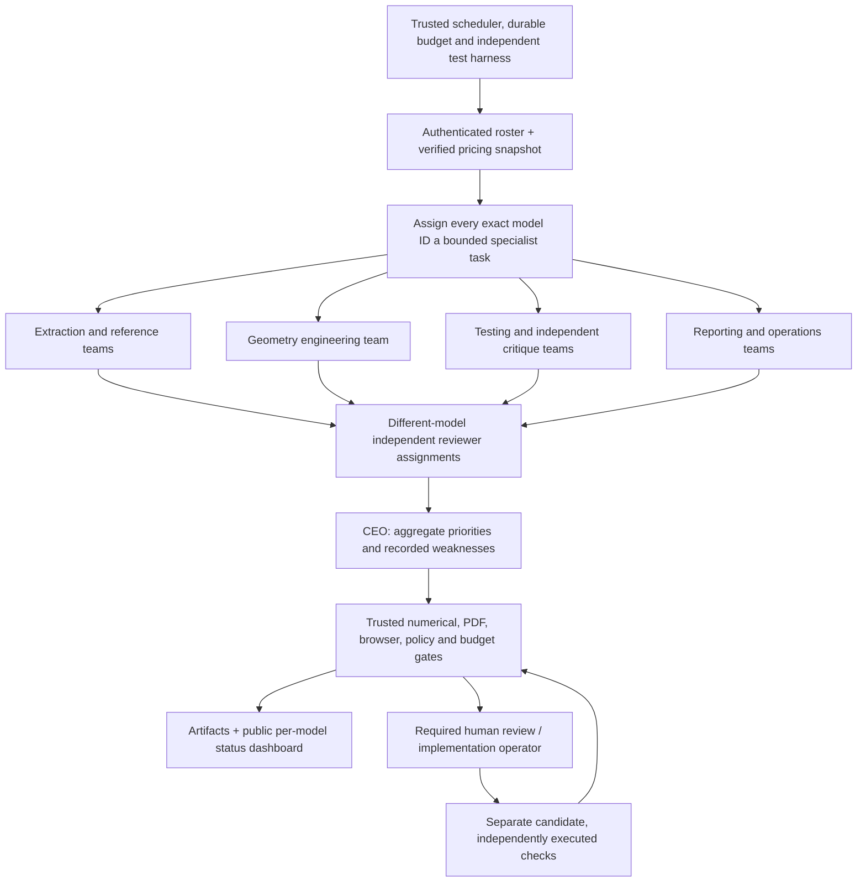

# Every-model APINEX service — design and implementation ledger

Design: 2026-11-27. This extends the existing reviewed organization rather than
changing roof quantities. The user explicitly requested every APINEX model and
previously authorized $20 per rolling week. Models propose work; trusted code
measures, checks artifacts, and enforces release policy.

## Verified baseline and scope

The deployed laboratory called only Astra (critic) and Opus (CEO). Its provider
had prices for only those two IDs. Fresh authenticated `/v1/models` and the public
catalog contain 45 matching IDs. A roster entry alone does not prove entitlement,
modality, reliable structured output, or roof-measurement skill. Catalog changes
and blocked models must remain visible. No silent provider/model substitutions.

Nine additional IDs appear in documentation but are absent from both live
catalogs: `claude-fable-5.1`, `free/jev-1.13`, `gemini-3.1-pro`, `gpt-5.6-terra`,
`gpt-6-astra`, `gpt-6-luna-decisions`, `gpt-6.1-sol`, `kimi-k3` and
`subq-snap-preview`. They are displayed separately as unavailable; a similarly
named model never substitutes for them.

The previous hosted CEO misstated numerical results despite passing JSON schema.
Trusted results were 4/12 diagnostic passes, 8 review-required cases, validation
1/3 passing and holdout 2/3 passing. The release gate correctly stayed closed.
Fleet results therefore include typed metric claims checked against trusted facts;
the dashboard renders counts directly from deterministic evidence. Valid claims
do not establish that every sentence in model prose is correct.

## Organization and handoffs

Every catalog model gets an exact-ID assignment with team, existing role contract,
specific task and a different-model reviewer. Assignments use prior empirical
evidence where available and otherwise remain provisional. Text-only development
evidence is initially sent to all models: no unsupported vision capability is
assumed. The two documented paid decision models use their typed Decisions
endpoint for diagnostic/report classification; host adapters do not pretend that
categorical outputs contain prose, metric echoes or peer reviews. Their actual
classifications are checked against supplied facts and reviewed by another model.
Extraction models examine literal generated report observations;
reference models inspect source/split provenance; engineers propose hypotheses
for recorded geometry defects; critics challenge proposals; verifiers identify
independently runnable checks; reporting models review consistency/readability;
operations models diagnose bounded workflow failures. No model executes patches
or invents measurements. CEO runs last and receives aggregate results; authors
never approve their own proposals. A reviewer assignment is not recorded as a
completed review unless an actual review response exists.

## Execution, schemas and failure recovery

Preserve the existing two-role cycle as a compatibility mode. Add a fleet mode
using the existing SQLite queue, fencing, content-addressed evidence, reservations,
dispatch markers and usage settlement. Tasks bind source, fixture, policy and
candidate hashes. One request at a time, at most one primary attempt/model/evaluation
plus bounded closing reviews by different models (within 64 total requests),
45 seconds/request, 2,000 output tokens, and a bounded catalog size. Re-running an
evaluation reuses terminal results; ambiguous dispatched work is never resent.
Checkpoints and the same global GitHub concurrency group preserve budget lineage.

Public `models` rows contain only bounded model/team/role/task/reviewer identifiers,
status, safe blocker code, decision and reported cost. No raw prompts, responses,
credentials, source documents, customer details or provider error bodies. Artifacts
retain private audit evidence. The dashboard supports old two-model records and
labels stale, incomplete, disabled and failed status explicitly.

Permanent model-specific errors block that model, rather than stopping unrelated
models. Authentication failure blocks the provider; rate limits pause the affected
allowance/provider without hammering it. Unknown pricing or unsupported models
remain visible and blocked. New catalog IDs require verified prices before paid
dispatch. Exact returned-model identity and local role schemas remain mandatory.
No paid fallback replaces a free model that has exhausted its allowance.

Fleet limits: at most 64 model requests/cycle, one in flight, $3/workflow,
$3/rolling hour, $3/rolling day, $20/rolling 7 days and $80/UTC month. The $3
reservation ceiling leaves capacity for CEO and visual-review holds after
other provider timeouts; it does not increase the user's weekly limit.
Explicit zero budgets disable inference. All paid/free allowance use is recorded;
unknown billing retains its conservative reservation. No idle model calls.
The text fleet has a 40-minute deadline inside a 70-minute hosted job, leaving time to
run a bounded 15-minute design phase, perform visual review, close the database, upload checkpoints and retain artifacts. Unstarted work is
explicitly deferred when the remaining runtime cannot accommodate another call.

The GitHub scheduler runs bounded cycles independently of this chat and the user's
computer. It is not a continuously busy daemon. Models do useful specialist work
on each eligible evaluation, with blocked or exhausted work exposed to operators.
Customer report quantities and segmentation-free output remain unchanged.

## Acceptance and deployment

1. Save verified catalog, exact IDs, pricing/capability claims and source hashes.
2. Test all-ID assignment coverage, deterministic routing, independent reviewers,
   metric-claim checks, budget and crash recovery, per-model failures and quota stops.
3. Run a budgeted live fleet on generated development evidence; retain every
   success, rejected contract, entitlement failure and usage record.
4. Independently inspect the dashboard at desktop/mobile sizes and compare its
   counts and statuses with artifacts. A successful request is not a skill pass.
5. Pass repository checks on the frozen runtime revision. Update only the reviewed
   scheduler source pin and dashboard assets on main, preserving the roof app.
6. Verify hosted execution, retained checkpoint, exact model coverage and public
   status. Roll back by restoring the previous immutable pin; retain the ledger.

Codex implementation agents own separate code modules and are not APINEX runtime
agents. Root owns integration, independent review and release evidence. The fleet
is complete only when every roster ID is either actually attempted or shown with
a precise access/pricing/budget blocker; no model is silently omitted.

## Image design studio extension

The user additionally requested the image models shown in APINEX's media catalog.
This is a separate catalog from the authenticated chat/Decisions roster. All six
image IDs are assigned actual concept-generation tasks through the documented
`/v1/images/generations` endpoint, with one image per model per evaluation.

| Exact image model | Design assignment |
| --- | --- |
| `free/nano-banana-2` | Mobile roof workspace and accessible controls |
| `nano-banana-2` | Grayscale Diversity Contracting report cover and branding |
| `gpt-image-2.6-flare` | Consistent icons and roof-edge legend concepts |
| `gpt-image-2.6-sunburst` | Letter-page typography and measurement schedule layout |
| `seedream-5` | Brand consistency across report components |
| `grok-imagine-2` | Error, uncertainty and manual-review screen concepts |

Generated pixels are design proposals, never source imagery, roof geometry,
reference data or measurement truth. Product changes require independent visual
review and normal repository checks; a generated concept never replaces the app
automatically. Retained concepts include original image bytes, hashes, model
requests, cost evidence and a gallery. A different vision-capable model reviews
the actual generated bytes. Missing images, unreadable text and incomplete review
remain explicit. Image APIs that omit returned model identity are recorded as
unattested instead of fabricating an identity match.

Verified flat image prices reserve funds before dispatch. Missing billing retains
the reservation. Free Nano uses a separate 5-million-token image allowance and
requires actual subscription/quota eligibility; it never falls back to a paid
model. Text, Decisions, images and visual review share one persisted ledger and
the same $20 rolling-week limit. All-model cycles reserve request capacity for
the six image tasks and their visual review within the total 64-call ceiling.

## Current work

- Completed: 45 text/decision and six image-model catalogs; endpoint/pricing audits;
  specialist assignments; durable budgeted execution; typed numerical grounding;
  independent model/visual review; responsive status dashboard and regression tests.
- Completed: hosted all-model cycle and targeted retained-baseline follow-up;
  budget admission, bounded provider-error diagnostics, five original raster
  concepts and independent review of their actual pixels. The dashboard is live.
- Completed: retained raster-validation counts and a combined six-model design
  manifest. Independent replay of actual hosted evidence made zero API calls,
  preserved the entire ledger, and recovered the same five reviewed images.
- Next: address recorded provider/contract failures and implement only independently
  reviewed design changes through normal application checks.
- Known limits: generated evidence is not field accuracy; catalog claims are not
  task qualification; subscription access and free allowance must be observed.

## Retained-baseline recovery

A manual `review-existing` operation downloads a selected completed laboratory
artifact and restores the latest shared budget checkpoint. It verifies original
case/report/image hashes, preserves original measurement provenance, and performs
only the missing visual and CEO reviews. It generates no measurements or PDFs.

`generate_missing_designs` is off by default. Enabling it admits at most one new,
explicitly versioned qualification for each of three original image HTTP failures,
with fresh prices, circuit/quota checks, a separate prompt/evaluation identity and
retained old reservations. It does not replay transport-ambiguous requests. These
three requests plus visual and CEO review admit at most five additional dispatches
under the same original workflow budget, never more than 64 total requests.

The first full hosted run (`46089368732`, `c96c45c`) dispatched 50 of 51 models,
validated 11 text/typed contributions, and generated three original concepts.
Twenty-four text timeouts and eight invalid outputs remain recorded. Six of
12 synthetic cases passed diagnostics; all 12 PDFs passed readback. New reported
fees were $0.065505; unknown holds of $1.8116064 remained charged conservatively.
The old $2 per-job policy blocked CEO and visual review. The $3 policy addresses
that admission defect without changing the $20 rolling-week ceiling or refunding
any unknown cost. Follow-up output distinguishes retained PDFs, newly generated
concepts, the original measurement source and the current review operator.

The targeted run (`46093943711`, operator `edce25e`) exercised the remaining CEO,
bringing actual unique model dispatch coverage to 51/51. Flare and Sunburst
returned original images, bringing the concept collection to five. Paid Nano
returned HTTP 502; its previous failed request and unknown reservation remain.
Terra reviewed all five actual images with exact model/hash evidence and returned
`needs-human`. Opus executed but returned contradictory envelope/payload decisions;
the response remains rejected. The prompt now states the validator's existing
decision mapping explicitly, without relabeling that failed response.

The follow-up added exactly five requests. All 48 baseline case/oracle/report/PDF
files remained byte-identical and all 31 original unknown holds remained. The
cumulative ledger records 57 requests, $0.08325 reported, $2.0448564 committed
including 34 unknown-billing reservations. These are distinct from provider
invoices and remain subject to the shared rolling-week ceiling. There are 11
validated text/typed contributions and five format-validated raster concepts;
neither count means the designs are production-ready or roof accuracy is proven.
Known visual defects include low contrast, tiny text, inconsistent units,
misspelling and an unsupported inferred-status claim. The customer report and
measurement algorithms are unchanged by the design studio.
