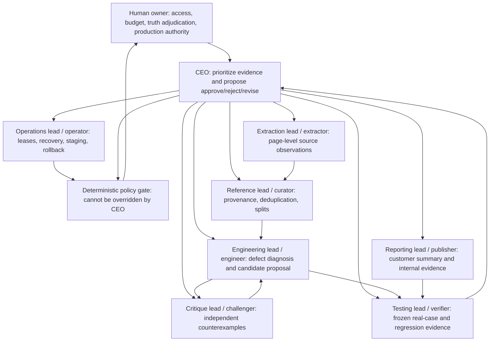
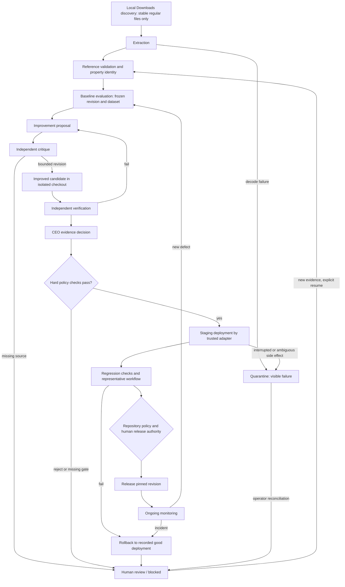

# Continuous improvement organization — design v1

Design date: 2026-11-27. Phase 1 precedes implementation. This control plane is
separate from the existing transient image-review runtime and does not change
roof measurement algorithms. A continuously available service is not permission
for continuous paid inference or automatic production release.

## Baseline and verified interfaces

Inspected source: `4806a12`; clean working tree at inspection. Node 24 runtime,
static frontend, `server/agents.mjs` five-role roof review, strict local contracts,
`server/geometry.mjs` deterministic quantities, owner-bound in-memory HTTP jobs,
`ai-report.js` source-image review PDF and `.github/workflows/tests.yml`.
Existing geometry remains REVIEW REQUIRED. Customer references are private.

On this date authenticated `GET https://api.apinex.bond/v1/models` succeeded:
45 IDs; `claude-opus-5.5` and `gpt-6.2-astra` were present. No chat call was made
for design discovery. Listing is not entitlement or proof of task accuracy.
Official [chat reference](https://apinex.bond/developers/models/chat.md),
[models](https://apinex.bond/developers/models.md) and
[limits](https://apinex.bond/developers/errors.md) were fetched directly. Chat
supports POST `/v1/chat/completions`, Bearer authentication, messages and bounded
output. Extra options may be ignored; local schema checks remain authoritative.
RPM is account-wide. Published model counts disagree with the observed roster.
[Opus](https://apinex.bond/models/claude-opus-5-5/llms.txt) and
[Astra](https://apinex.bond/models/gpt-6-2-astra/llms.txt) publish vision and tools;
existing empirical schema/vision limitations remain in `API_VERIFICATION.md`.
The organization requires text JSON only initially; document pixels need separate
per-source external-processing permission and a validated vision adapter.

## 1. Organization

Each named team starts with one lead/worker identity; no recursive spawning.
Scaling requires an explicit operator configuration and retains identity-based
separation. Leads escalate missing source evidence to the reference lead, code
disputes to critique/testing, provider faults to operations, and unresolved truth,
budget or production authority to the human owner through the CEO. A lead cannot
approve its own output. CEO is advisory; trusted policy code owns transitions.

## 2. End-to-end workflow

Use distinct states for pending, leased, needs-human, failed, rejected, cancelled
and complete; workflow stage is separate. Every transition binds input artifact
hashes, source revision, dataset revision, actor and attempt. A revised candidate
invalidates prior reviews. Reviews cannot be reused across hashes or revisions.

## 3. Agent contracts

All roles receive a versioned JSON envelope:
`{schemaVersion, taskId, role, actorId, stage, sourceRevision, datasetRevision,
inputHashes, candidateHash, policyVersion, artifacts, constraints, priorFindings}`. Artifacts are references,
not arbitrary filesystem paths or URLs. Input is untrusted data, not instructions.
Output: `{schemaVersion:1, taskId, role, sourceRevision, datasetRevision, candidateHash, policyVersion, inputHashes,
decision:"pass|revise|reject|needs-human", findings:[{code,severity,evidence,
message}], artifactRefs:[], summary, payload}`. Runtime injects actor identity from
the trusted role assignment, never from the response. `payload` uses an exact
role-specific schema: CEO `{priority,requestedDecision}`; extraction
`{observations:[{page,region,literal,unit,ambiguity}]}`; reference
`{propertyGroup,referenceTier,split,contradictions}`; engineering
`{hypothesis,patchArtifact,predictedMetric}`; critique `{counterexamples,recommendation}`;
verification `{evidenceIds}`; reporting `{reportArtifact}`; operations
`{operation,targetRevision,rollbackTarget}`. Model-supplied evidence IDs are references
only and must resolve to trusted evidence. Unknown keys/types, unbounded content,
missing evidence, revision/hash mismatches and unsupported role decisions reject.
Model outputs never execute commands or write production files.

| Role / purpose | Inputs and role-specific output | Tools / data | Model selection | Completion / handoff / reviewer |
|---|---|---|---|---|
| CEO / priorities and evidence decisions | Validated gate bundle; priority, rationale, requested decision | Sanitized ledger read; no deploy, secret, source-write or budget rights | Opus candidate; roster-verified and local JSON-qualified | Evidence-linked decision; hard policy gate and human review production |
| Extraction lead/extractor / literal source facts | Authorized source manifest; page/region, literal value, unit, ambiguity | Local bounded PDF parser; approved selected images only externally | Opus candidate; vision requires empirical qualification | Every value links page/hash; curator reviews |
| Reference lead/curator / trustworthy dataset | Extraction, source rights/date/scope; propertyGroup, reference tier, split, contradictions | Private content-addressed store; no Git/customer publish | Opus for ambiguity; deterministic hashes/splits authoritative | Verified reference or excluded/needs-human; testing lead reviews |
| Engineering lead/engineer / candidate | Baseline defects and development-only inputs; patch proposal, hypothesis, predicted metric | Read-only source snippets; patches applied only by implementation operator in isolated checkout | Astra candidate; coding qualification required | Reproducible defect and candidate hash; critique then independent verifier |
| Critique lead/challenger / challenge and improve | Proposal + permitted source evidence, not verifier expected results; counterexamples and revised proposal | Read-only candidate; bounded synthetic test proposals | Opus separate context/actor from author | Material findings resolved; independent verifier reviews candidate |
| Testing lead/verifier / independent correctness | Frozen baseline/candidate, protected reference manifest; signed test evidence, metric deltas, exclusions | Trusted allowlisted test adapter; holdout inaccessible to author | Astra isolated actor; numerical computation is deterministic | Actual exit codes/artifact hashes, all critical gates; CEO considers, policy enforces |
| Reporting lead/publisher / consistent customer report | Accepted quantities, source/review status; text/table-only customer projection | Sanitized export writer; internal geometry separate | Opus text quality review; quantities never generated by LLM | No segmentation image/vertices/source imagery in customer projection; verifier checks schema/layout |
| Operations lead/operator / reliable service | Leases, health, budget, stage/release records; recovery or deployment request | Local supervisor; explicit trusted deployment adapter only | Astra diagnosis; service operations deterministic | Actual logs, revision and rollback target; human release authority |

The choice is provisional task routing, not a universal accuracy claim. Other
roster models may qualify against the same frozen role fixtures; no model is
called merely to keep it busy. No silent fallback provider/model. Existing roof
runtime retains its own per-image consent and contracts.

Shared limits: one local worker/DB instance initially; one in-flight model call;
two attempts total per stage for transient faults, 45s request/120s task deadline,
2 MiB provider response/64 KiB accepted structured output, 2,000 output tokens,
max 2 revision cycles and 16 total stages per improvement. No-progress revision
requires human input. Global hourly/daily and per-workflow request/cost ceilings
are explicit configuration; zero means disabled, never enlarged automatically.
Reserve conservative full model context at verified maximum token rate before
dispatch. Persist reservation before send; ambiguous billing retains reservation.
Default paid-call budget is zero. Retries spend a fresh reservation, honor bounded
Retry-After, and never retry 400/401/403. Exhausted limits block visibly. No agent
can alter these limits. Account-wide RPM shared with the existing runtime requires
an operator-assigned organization allocation, not assumed account capacity.

## 4. Continuous operation

### Local and cloud boundaries

Local Node 24 worker runs under the user's OS identity, with an explicitly
configured absolute Downloads directory (Windows `%USERPROFILE%/Downloads`, macOS
`~/Downloads`, Linux XDG path are suggestions, never cloud assumptions). An initial
discovery preview and allowlisted extensions precede import. It ignores symlinks,
partial downloads, ZIPs until explicitly supported, files outside the root, files
over 16 MiB, and files modified during a stable-read window. No automatic external
upload. The current cloud executor cannot access the user's local Downloads.

Node SQLite WAL on a durable local volume stores tasks, events, leases, source
hashes, decisions and budget reservations transactionally. Private hash-addressed
blobs live beside it with restrictive permissions; DB stores relative artifact
IDs only. Same source bytes deduplicate globally; near-duplicate/property matches
enter curator review before splits. SQLite is single-host, not shared NFS/replica.
Cloud workers need explicit authorized artifact transfer and their own durable
database/object store; never mount a user's entire Downloads or put keys in UI.

### Scheduling and recovery

Use filesystem watch as an optimization, plus 60-second reconciliation scans;
stable candidates require two identical stats separated by at least 2 seconds.
Hash bytes and commit blob + manifest before queueing; repeated scans are idempotent.
Idle does zero inference. A polling worker sleeps interruptibly between checks.
Lease acquisition and attempt increment are atomic. Leases have owner and fencing
token. Heartbeat renews only the current lease. Crash before inference dispatch is
retryable; persisted dispatched requests with unknown outcome become needs-human,
never automatically resubmitted. Late completions cannot overwrite newer state.
Deploy/release side effects use an outbox and idempotency key; ambiguous outcome
blocks for reconciliation. No shell strings from model responses.

Transaction protocol: `BEGIN IMMEDIATE` admits only pending/retryable tasks within
attempt limits, increments the fence and commits a lease. Before send, atomically
insert reserved/not-sent capacity against workflow/hour/day budgets. Mark dispatched
and commit immediately before send. A crash in the mark/send gap is ambiguous and
requires reconciliation. Only current unexpired fences can complete or settle.
Unknown reservations survive restart; no automatic refund or resubmission.
Deployment retries require verified adapter idempotency and reconciliation support;
otherwise ambiguous calls block. An actual debit exceeding reservation raises an
incident and blocks admission. Model decisions never release reservations.

### Controls

CLI: discover, status, start/run, pause, resume, stop, cancel, review, reconcile,
and rollback. Pause stops admission and leaves active work to checkpoint; stop
aborts active requests and conservatively retains billing reservation. Resume
does not erase exhausted budgets or review requirements. Rollback references a
verified earlier deployment digest; it never rewrites Git or silently deletes data.
An operations request is not a completed deployment.

Provide systemd user-service, macOS launchd and Windows Task Scheduler setup
instructions/templates. Installation/startup registration is explicit operator
action. Crash restart uses the same durable directory. Do not install a background
service or enable paid work automatically in the cloud session.
Backup DB through SQLite backup/checkpoint discipline, not live file copying.
SQLite is not encrypted by this implementation: private production data requires
an OS-encrypted volume and owner-managed backup encryption/key recovery. Without
verified encrypted storage, use synthetic/public data only. Private blobs/DB are
retained under owner policy, deletion tracked in audit.

## 5. Improvement and approval rules

Author proposes → different actor critiques → author revises (max twice) → different
actor independently verifies frozen candidate → CEO recommends → deterministic
policy decides eligible/blocked. Author, critic and verifier identities are distinct;
CEO cannot substitute for verifier. Review evidence binds exact candidate, inputs,
dataset split and test command version. Verifier authors cannot self-certify a
changed verifier harness; changes to evaluation policy require human approval.
Trusted evidence is issued only by a fixed allowlisted harness adapter, with an
immutable ID, command version, actual exit code, artifact hash, candidate hash,
dataset revision and policy version. Models and generic CLI submissions cannot
mint passing check records. Imported evidence is untrusted until independently
reproduced. Stage/release records require trusted adapter receipts, not booleans.

Human approvals bind the identical candidate/dataset/policy bundle and a trusted
operator identity with explicit scope. Baseline and candidate verification are
separate testing-role tasks with distinct actors and frozen harness versions.
Hard gates: schema and provenance valid; no critical findings; actual baseline and
candidate checks pass; no holdout regression under preregistered criteria; numerical
and report consistency pass; source rights/consent valid; remaining budget valid;
staging checks pass before release; required human release approval and repository
policy satisfied. Missing tests are not passes. CEO pass never overrides gates.
Each revision must identify a measured improvement without critical regression;
after two cycles or unchanged metrics, needs-human. No recursive agent spawning.

## 6. Validation and customer report design

Thousands of reports enter as immutable source manifests with SHA256, original
filename kept private, received/source/imagery dates, provider, page/region,
property-group identity, roof/building scope, units, permissions and reference tier.
Printed report numbers are source claims until independently validated. Conflicting
versions remain separate with reconciliation evidence. A curator approves truth;
AI extraction alone cannot create verified reference data. Parse locally first.

Deterministic property-group split: hash stable canonical property identity plus a
fixed dataset salt into development/validation/holdout (70/15/15). All pages,
duplicates, addresses/aliases, dates and crops of the same property stay together.
Missing property identity is quarantined, not randomly split. Later duplicate-group
merges crossing splits invalidate affected evaluations; rebuild/version the dataset.
Never expose holdout answers to proposing/critique agents. Separate manifests
alone are insufficient: production verification runs under a separate OS identity
or cloud job with private holdout mount and no author/critic access. Author workers
receive development-only artifacts through an allowlisted projection. Until that
boundary is configured and verified, mark holdout evidence non-independent and
block commercial/release approval. Logs never leak expected holdout values.

Baseline pins source commit, parser/model/prompt versions, source hashes and split.
Report area absolute/relative error (projected/sloped separately), per-edge absolute
error and type confusion, facet misses/extras, wrong-building rate, boundary IoU
(diagnostic only), unknown/abstention and correction rate, latency/cost/failure rate.
Show median, p90/p95, worst case, sample counts and property-cluster intervals.
No post-hoc exclusions; missing/error results stay failures/coverage losses.
Synthetic numeric invariants use known analytic answers and scale-aware floating
tolerances. Field tolerances require documented source precision, estimator use
case and human-approved preregistration; no arbitrary few-percent marketing claim.
Until verified field truth/tolerances exist, commercial accuracy gate is blocked.

Customer report projection is allowlisted tables/text only: job/revision/date,
building scope, area/squares, pitch categories, edge totals, exclusions, source
quality and review notes; waste scenarios are explicitly assumptions. **No roof
segmentation imagery**, internal vertices, source images or overlay payloads in
customer output. Original internal plan-first review remains available privately.
The new customer projection requires its own rendered PDF check before use; a
validated JSON projection alone is not a visually validated customer PDF.
Internal geometry, extraction regions, source images, original model responses,
hashes, quantities and correction history remain private for verification.

## 7. Implementation stages and rollback

| Stage | Owner / dependency | Acceptance |
|---|---|---|
| 0 Design + independent review | Supervisor, then independent Codex design reviewer | Resolve material gaps in this document before application code |
| 1 Contracts and policy | Codex contracts implementer | Strict envelopes, identity separation, stale review and failed gate rejection |
| 2 Durable queue/artifacts | Codex persistence implementer; stage 1 interface | Crash/restart, dedup, fencing, reservations and private path tests |
| 3 Local discovery/controls | Supervisor; stage 2 | Stable files, traversal/symlink protection, restart and pause/stop tests |
| 4 API NEX adapter | Codex provider implementer; stage 1/2 | Roster verification, no-call zero budget, strict bounded replies, permanent/transient cases |
| 5 Reference/report adapters | Supervisor; stages 1/2 | Property split/leak prevention, allowlisted no-image projection |
| 6 Integration/operations | Supervisor + independent verifier | Synthetic end-to-end restart/approval/rejection; existing suites pass; runbook |
| 7 Authorized local pilot/staging | Human local operator + ops | Real Downloads root and persistent service; source authorization and budget; actual deployment logs |

Codex implementation subagents edit/test repository code during this development
session. API NEX runtime agents are the deployed roles above. Neither represents
an installed always-on service until installation and actual health are verified.
Trusted adapters initially block unsupported extraction, baseline, code application,
deployment and release operations; fail closed rather than fabricate evidence.
Implement extensions incrementally behind explicit adapter registration. Existing
roof UI/runtime is unaffected; rollback stops organization worker and restores the
prior code revision without deleting its ledger. Schema versions reject incompatible
state, migrations require backup; deployments record previous known-good digest.

## Design review record

Independent reviewer identified envelope/binding, evidence issuer, holdout access
and encryption gaps; revised above before implementation. Detailed review and
final disposition are recorded separately. No implementation begun when the
original draft was saved.

## Capability/status disclosure required at every delivery

Each adapter reports implemented, deterministic-test-only, unavailable, or installed
and observed healthy. Initially no local user's Downloads mount, OS service,
private holdout boundary or production deployment is installed in this cloud.
A queue/CLI/JSON projection is not a complete extraction-to-release organization.
Unsupported stages must expose needs-human with exact missing adapter/access.
Backup restore checks compare source hashes, DB integrity and event counts; deleting
active data does not claim erasure of prior owner-managed encrypted backups.

Review disposition: six material findings accepted and resolved in the design:
strict role payload/bundle binding; trusted evidence issuance; actual holdout
boundary; OS encryption prerequisite; transactional dispatch/recovery; explicit
capability disclosure. Independent reviewer found this bounded foundation suitable
after these revisions. Implementation may now begin; field accuracy/release remain
gated by reference evidence and actual operational adapters.

## Full requirements addendum — supplied during implementation

The complete user request additionally requires recursive Downloads inventory,
monthly spending caps, extraction of units/pitch/provider/date/property identifiers,
explicit retry/rollback controls, startup verification and no segmentation imagery
in the actual application's customer preview/export. These extend the reviewed
foundation; they do not relax its hard gates or authorize data fabrication.

Inventory recursively under configured local root with no symlink traversal,
bounded depth/files/bytes and visible skipped/unsupported/inaccessible counts.
Roof relevance is an explicit filename/content classifier with uncertain cases
quarantined; no unrelated personal documents are sent externally. Cache extraction
by source hash and parser version. Local extraction yields literal source claims,
not verified truth. Source hash + page + text region remain attached to normalized
area/length/pitch/date/provider/property candidates. Validate a representative batch
against source before full processing; inventory never masquerades as completed
review. Actual user's Downloads is unavailable to this cloud and remains blocked.

Budget admission adds monthly cap (UTC calendar month, versus rolling hour/day/seven-day windows)
to per-workflow/hour/day caps. Retry requires a fresh bounded admission and known
safe outcome; unknown dispatched requests remain blocked. Operator retry cannot
reset cumulative budget/attempt accounting. A meaningful notification is a durable
ledger event/CLI attention item; no unsolicited email or messaging is authorized.

Actual frontend customer reports default to no segmentation diagrams/overlays;
private internal review retains the geometric plan. Export and preview share bytes.
A standalone customer JSON/PDF adapter is separately tested; both retain unknowns,
provenance and quantity statuses, and never certify field accuracy. Any altered
report tests preserve numerical and internal geometry coverage.

Installation templates are deliverables, not evidence of installed services. Real
host restart, real Downloads processing, real-property accuracy and deployed-user
flow remain unverified until actual host/access/adapters exist. The service runbook
must state power/network/cloud dependencies and report counters without inventing
unique-property or field results. Additional implementation ownership: supervisor
inventory/extraction and CLI; persistence implementer monthly budget; dedicated
report implementer actual customer preview/export; independent review reruns.

## Post-reconciliation baseline

The initial inspection preceded remote reconciliation. Remote branch advanced to
`5c10081`; local organization/report changes were rebased on it, preserving its
measurement safeguards, specialist evaluation artifacts and `server/job-store.mjs`
review recovery. The old image-review runtime now has durable admitted-result
recovery; it still is distinct from the new organization scheduler/database.
No claim of real-field accuracy or production deployment is inferred from those
remote changes. The design's original transient baseline describes `4806a12` only.
