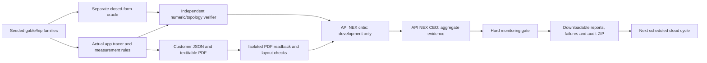

# Self-contained cloud roof laboratory

This mode replaces the requirement to access Windows Downloads. It generates
its own reproducible cases and reports, runs the unchanged app tracer, checks
against separate analytic geometry and reads back the produced PDFs. It does
not copy a personal Downloads collection or use its own PDFs as ground truth.
Local report intake remains optional and separate.

## Workflow and scope



Default:12 renditions of4 property families, with clear, noisy/blurred and
tree/clutter variants. First4 families have development/development/validation/
holdout assignments; aliases/renditions stay together. This small cohort is
50/25/25, not an assertion of70/15/15 sampling. The holdout has one hip family;
it does not qualify all roof classes. More families use the frozen hash split.
Maximum48 cases per cycle. Unsupported valleys, dormers, multilevel roofs,
wrong-building selection and real aerial accuracy are not qualified by these
single-wing generated tests.

Analytic reference vertices, pitches, areas and individual3D edges are defined
before tracing and never derived from generated reports/model agreement. The
unchanged `traceBuildingV2` executes in the headless browser-code harness, followed
by app-rule quantities. The scheduled workflow separately exercises the actual
browser upload/edit/calibration/reopen/PDF/ZIP path on analytic UI fixtures.

The independent verifier ignores benchmark-supplied expected values when checking
candidate errors, rejects duplicated correspondences and retains all failures.
Frozen5% numeric diagnostics are engineering tests, not a customer field-accuracy
promise. Missing or extra facets/edges still fail even when total area is close.
PDF verification independently checks row values/units/status/source, metadata,
Letter bounds, readability/contrast and no images/drawn paths. PDF consistency
does not establish geometry accuracy.

## Model reviews and decisions

Actual API NEX text requests use `gpt-6.2-astra` for independent critique and
`claude-opus-5.5` for CEO prioritization. Exact IDs are roster-checked before calls.
Critic inputs contain development-only case details and metrics; CEO receives
full aggregate results and the validated critique, without held-out oracle rows.
Tasks bind source/generator/engine/policy/fixture hashes and preserve original
replies, local schema validation, prompt version, request IDs and reported costs.
One complete single JSON code fence can be removed as compatible formatting;
prose/multiple blocks and invalid role contracts still reject.

There are at most2 requests/cycle,1 per role; same evaluation identity reuses
recorded decisions rather than paying again. Unknown costs retain reservations.
Permanent provider faults open a persisted circuit instead of spending every day. Clearing such a circuit requires a trusted, ledger-preserving reconciliation; no automatic credential repair or circuit-reset command is claimed.
The existing$1/workflow,$3/rolling day,$20/rolling7days,$80/UTC-month ceilings apply.
Other account activity outside this ledger is not an account-wide spending cap.

The CEO cannot turn a failed numeric/PDF/browser check into a pass. Routine
failures remain `review-required`; future cycles continue collecting evidence.
This service monitors and proposes priorities. It does not execute model code,
merge measurement patches, certify roofs or promote production releases.
Comparing two different daily seeds is not a before/after improvement study;
candidate improvements require paired frozen input hashes.

## Cloud operation and downloads

`.github/workflows/roof-cloud.yml` defines a daily03:17UTC job plus manual dispatch.
In New York that is10:17PM previous day during standard time and11:17PM during
daylight time. Scheduling is best-effort GitHub infrastructure, not an always-busy
daemon. It runs without the user's computer or an open chat/browser.

GitHub schedules require the workflow on the default branch. Deployment uses an
operations-only PR based on main that pins the CI-verified runtime commit; it
does not merge the full application PR. Source revisions are explicit and frozen
in every result. The source pin must be reviewed/updated to test new app code.

The workflow has one global concurrency group and never cancels an active run.
It restores the newest relevant checkpoint across all branches, including failed
or cancelled predecessors, not just the newest success. Missing/corrupt/expired
history disables paid work permanently in subsequent checkpoints until legitimate
reconciliation; it cannot silently reset a budget. Known-unstarted queued runs
are not mistaken for paid predecessors. SQLite is closed before artifact capture.
Failed cycles still attempt to archive state and evidence. Deterministic reports
can continue while paid review is disabled; this is explicitly reported.

Reports and state are retained as named GitHub Actions artifacts for90days. Open
the latest [cloud run](https://github.com/musabtheone11/roof-measure/actions/workflows/roof-cloud.yml),
download its report artifact, extract it and open `cloud-output/index.html` or
individual PDFs. `roof-reports.zip` inside that folder includes reports and audit
JSON. Artifacts require GitHub access and expire; this is not permanent archival
or a public customer SaaS account system. No personal files are uploaded.

A separate publication job journals an allowlisted small status record to
`roof-cloud-status/latest-status.json` using compare-and-swap writes, not a forced
branch overwrite. Its content-write token is separate from the model job; it has
no API NEX secret. Legitimate daily evaluation journal commits also provide
repository activity; GitHub otherwise disables public-repository schedules after
60days of inactivity. Check actual status/health and do not assume indefinite uptime.
Official behavior: [GitHub workflow events](https://docs.github.com/en/actions/reference/workflows-and-actions/events-that-trigger-workflows#schedule).

## Credentials and controls

Recurring model calls require an Actions secret named `ROOF_ORG_APINEX_API_KEY`
or existing `APINEX_API_KEY`, plus a valid paid-state lineage. Authentication must
succeed from the hosted runner, not merely from the development cloud. This
session's GitHub integration returned403 for Actions secret public-key/write
endpoints, so secret installation could not be completed through that credential.
Never commit a key or put it into a report/workflow file. A missing secret means
deterministic evaluation continues and model review is reported as disabled.

Pause the hosted service by disabling the workflow; resume by enabling it. Use
manual dispatch for an immediate bounded cycle. Cancel only with awareness that
a lost checkpoint may intentionally block later paid work. Roll back the scheduler
source pin through a reviewed workflow change; no force push or budget deletion.

Local reproduction (Node24, pinned root+bench dependencies):

```sh
npm ci --ignore-scripts
npm ci --prefix bench --ignore-scripts
npm run org:cloud -- --state .devcache/cloud-state --output .devcache/cloud-output --seed 20261127 --count 12
npm run test:cloud
```

That command defaults to no paid inference. A trusted operator may enable the
existing key with `ROOF_CLOUD_PAID_ALLOWED=true`, retaining the same state directory
and authorized limits; never use a new directory to reset spending history.

## Initial observed evidence

The development cloud generated12 PDFs and independently read back108 quantity
rows:12/12 PDF checks passed. Geometry:5 diagnostic passes and7 requiring review,
zero exclusions and zero actual tracer exceptions. Absolute area error median
0.69523%, p95/worst6.259547%;15 missed edges,53 unmatched emitted segments (48 roof edges and5 diagnostic obstruction lines),3 extra facets. These
are generated diagnostics, not real-property accuracy.

Two real API NEX calls reported$0.008389 total; both returned schema-valid
needs-human decisions and refused unsupported acceptance. The hard gate retained
review-required. That initial pilot exposed aggregate split metrics to critique;
the production adapter now restricts critique to development evidence. Treat the
pilot as development/validation, not an untouched holdout accuracy claim.

A confirmed evaluator exception was corrected: an extra diagnostic obstruction
edge had no physical length, and formatting `undefined` crashed evaluation. Its
length now remains null and the extra edge still fails verification. No production
roof measurement logic was changed by this correction.
