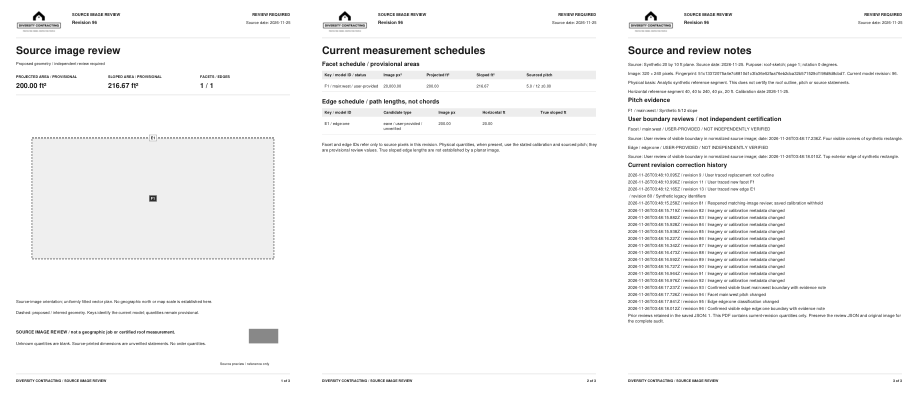

# Runtime integration validation

The new source-image editor is inside the existing application. It is a separate
review workspace: it does not silently place unlocated uploaded pixels on the
Google map or replace the saved job/PDF. Its export is revision-bound review JSON,
including original provider output, source metadata, user corrections and current
deterministic measurements. A geographic import requires verified georeferencing.

## Implemented roles

The runtime verifies the authenticated APINEX roster before processing. Opus 5.5
handles quality, exterior outline and adjudication; Astra 6.2 handles roof
structure and an independent outline that never sees the first trace. These are
provisional choices from limited synthetic trials, not proven universally best
models. A deterministic worker checks topology and computes quantities. The
independent outlines trigger review; their agreement cannot certify accuracy.

Every polygon is schema-validated. Exact single JSON code fences can be unwrapped
as compatible formatting, with the original response retained and normalization
recorded. Prose, multiple blocks and malformed content are rejected. Historical
candidate results in API_VERIFICATION.md used the earlier strict format parser;
this compatibility change does not retroactively turn those trials into passes.

The runtime has request/token/dollar ceilings, bounded concurrency and retries,
timeouts, cancellation, owner-bound jobs, stale-revision rejection and same-origin
CSRF checks. Because image token accounting is unpublished, a call reserves the
whole published model context at its verified price. This is intentionally more
conservative than typical actual usage; it is not a cost prediction.

## Checks and their limits

- Server tests exercise geometry, units, pitch, calibration, projection, topology,
  crop transforms, HTTP ownership, cancellation, CSRF and private-file denial.
- `bench/runtime-agents-test.mjs` sends actual HTTP requests to a local provider
  fixture. It checks contracts, independent input isolation, concurrency, retry,
  budget exhaustion, malformed outputs and stale/cancelled work. It makes no
  claim about paid-model accuracy.
- `tools/dev/ai-ui-test.mjs` drives Chromium against the actual application and
  deterministic measurement endpoint with a synthetic agent-response fixture.
  It verifies consent, 960 ft² calibrated horizontal area, sourced 6/12 pitch
  recalculation to 1,073.31 ft², vertex/edge correction, immutable original output,
  revision-current exports and clearing calibration when changing source images.
- Live APINEX requests were also exercised through the application. An initial
  five-call UI run returned useful outline/structure proposals and disagreements,
  with invalid quality/adjudication responses recorded. Later quality-gated runs
  stopped on invalid regions or a schematic-source refusal, withheld physical
  quantities and retained the reported cost. These are successful failure-path
  checks, not successful roof-accuracy checks. A later hardened run returned four
  schema-valid quality/outline/independent/structure outputs in 23.922 seconds
  ($0.002357 provider-reported debit). It identified a 1,326-pixel plane-coverage
  gap and withheld physical quantities. This is synthetic workflow verification,
  not field accuracy.

The browser regression uses a test-only managed-proxy TLS exception. Production
TLS verification is unchanged. No private customer imagery or reference reports
were sent to the provider in these runtime trials.

## Hosting

The repository's production deployment is legacy GitHub Pages from main/root.
It cannot run the secret-backed Node API. The feature branch leaves that deployment
unchanged. The Node preview is running on the managed environment's HTTP port
3000, but the environment status has not supplied a hosted preview URL. Therefore
an externally deployed-flow smoke test is not claimed. The shared-key service
must use an authenticated preview gateway; do not publish it as an unauthenticated
public API. Runtime jobs are transient and should be saved using the review export.

Uploads are normalized into a same-size PNG from the browser-decoded image, so
calibration and provider coordinates use the same orientation. Original file
metadata is preserved. PNG workflow tests pass; a dedicated JPEG EXIF-orientation
fixture has not been exercised. Rapid file-selection tests verify that the latest
selected image wins and cannot inherit the previous image calibration.

The final live integration run completed all five schema-valid APINEX roles,
including adjudication of the detected plane gap, in 30.375 seconds. Reported
debit was $0.004387. The unresolved gap and unknown pitch still withheld physical
quantities; adjudication did not promote its opinion into measurement evidence.

## Supervised continuation

The continuation adds local PDF.js 6.5.438 page rendering, hash-bound JSON reopen,
actual quarter-turn pixel transforms, literal sketch annotations, and revision-bound
source-image review PDFs. Both PDF.js and the existing jsPDF 2.5.1 are bundled
locally with licenses; model inference still requires explicit selected-image consent.
The original geographic report layout remains separate and unchanged.

Independent supervision reproduced and verified fixes for concurrent admission,
invalid/off-roof edges, enlarged explicit budgets, stale correction histories,
perspective gating, pending-source races, and short pen segments. A model response
may receive one bounded same-model schema repair; original attempts and their costs
remain visible. Unknown billing is never counted as a free failed request.

An authenticated, hardened Docker run completed one real synthetic APINEX job:
five schema-valid roles, 14,992 input and 2,273 output tokens, $0.007834 reported
debit. The first report attempt failed because the CDN library was unavailable
and the model lacked a selected exterior outline. These were real failures.
After local-library and honest missing-outline review fixes, a separate replay of
that saved output produced an 83,673-byte, three-page Letter PDF with CDN scripts
blocked and no browser errors. It displayed the missing outline and withheld
physical quantities. The replay made no API calls; it is not a second inference
trial or validated roof accuracy.

The final tested image hash was
`sha256:2103f61a3b2f8f59ebb9f9c38af6a01a43ee19315147320cb62d1c2e7c026da6`.
Synthetic proof is retained locally under `.devcache/deployment/`. An externally
reachable preview is still blocked by Vercel team authorization and remote secret
configuration. No public URL or production release is claimed.

Remaining supervised work includes cancellation before the creation response and
manual recovery of missing AI outlines; see the live supervision ledger.

## Human recovery and cancellation acceptance

The final key-free authenticated container replay used the saved actual AI output,
not a new provider response. Human canvas clicks supplied the four missing exterior
corners; sourced analytic 6/12 pitches were entered for the two actual candidate
facets. Deterministic validation passed and the UI/current JSON/three-page PDF
agreed on 960.00 ft² projected and 1,073.31 ft² sloped area. The PDF was 83,633 bytes.
All CDN scripts were blocked and browser errors were zero. Authenticated local
two-page PDF rendering and page replacement also passed with new fingerprint and
cleared model, consent and calibration.

Tested container: `sha256:b0a6c1801a7be9a50ea45c6a24bf8c41e348baddb0f9b7626ebe88f6736c8b3a`.
Source manifest: `572f99fa0a36ccbcb8fb35b7b98394b62397ea68e54f4af1db7d3c7ba0ee5ed6`.
Proof remains under `.devcache/deployment/`. These analytic measurements are not
a new field-accuracy benchmark. Paid inference for this Docker acceptance test was one five-call
job ($0.007834); both repair replays were key-free. Other candidate and protocol
trials are recorded separately in API_VERIFICATION.md and APINEX_REVIEW.md.

Request-nonce tests cover cancellation before POST, during a chunked body, after a
lost creation response, cross-owner denial, input-bound idempotency, failed creation
recovery and shutdown abortion. The browser challenge additionally holds a previous
DELETE response while the user presses Cancel: no queued analysis starts afterward,
and unconfirmed cancellation retains the same nonce for retry.

A 100-facet/100-edit fixture with 500 KB legacy AI data exported 980,519 bytes and
reopened 101 correction records. Raw evidence is retained once; correction records
contain changed-shape/metadata differences. Manual trace, removal, undo, target
switching, rotation and page/source replacement preserve source/revision safety.

When quality reports no target and the user has supplied no target point, the runtime
now stops after that quality call and asks for an intended-roof click. It does not
guess a center or infer an exterior boundary from the candidate facets.

## Final source and quantity safeguards

A later retry must not remove a known perspective warning. Source restrictions now
bind to the normalized image fingerprint and survive target selection, rotation,
undo, retries and imports. Legacy current/historical evidence with unresolved source
identity conservatively withholds physical quantities; explicitly different-image
evidence is not transferred. New archive entries retain source identity. Physical
boundary-comparison metrics are withheld with physical quantities; pixel diagnostics
remain available. Fresh-context and no-transient-value-flash regressions pass.

Explicitly unresolved facets have blank physical areas; unresolved, unspecified and
obstruction lines have blank physical roof lengths. Known facet rows remain, but a
total with an unresolved facet stays unknown. A required-note boundary confirmation
records user-provided evidence, date and fingerprint; pitch or classification edits
alone do not resolve geometry. Later geometry edits invalidate confirmation. The PDF
retains confirmation notes and clearly labels invalidated records. No such action
certifies perspective, scale, pitch or field accuracy.

The final accepted container replay used image
`sha256:420832adbcffe0aaa1590456cf43fc432351d3bec2e0e22d0296a224188f8728`,
source manifest `5bf1915e2f0fd8d13e6ef2b2f62b6d2a9f03031656de2d3686622575cb7d0eb5`.
It again passed human repair, current measurement and an 83,654-byte three-page PDF
with 960.00 / 1,073.31 ft², plus authenticated local multipage PDF import, with CDNs
blocked and no additional inference. Proof is final-accepted-container-proof.json
under the ignored deployment test directory.

The shared Cloud Browser visibly opened the private workspace at
`http://127.0.0.1:3000/` and its image-review dialog. That route exists only inside
the managed environment; it is not an externally published URL. Vercel team access
still returned HTTP 403. Production was not released.
## Manually traced source workflow on Windows

An operator can upload an authorized image, trace its outline, and add individual visible facets and edges. Each new facet and edge starts unresolved. The operator supplies a boundary note, classifies an edge, verifies a horizontal reference, and records the source and uncertainty of each known pitch. Editing a confirmed edge invalidates its review. Undo and redo recalculate the current revision. Selecting a new source clears the preceding property's audit from the active export.

**Test oracle.** The browser draws a 200 by 100 pixel rectangle. A 200 pixel segment represents 20 ft. Projected area is 200 ft², a 5/12 pitch gives 216.67 ft² sloped, and the top edge measures 20.00 ft horizontally. Tests check the downloadable JSON, printed PDF values, and ZIP archive against those expectations. The saved review PDF carries a review-required label. The ZIP contains the reviewed raster, JSON and PDF. A Python reader checks CRCs, fixed member names, revision and the SHA-256 of the raster. An uploaded PDF contributes its selected rendered page to the bundle.

**Browsers exercised.** Headless installed Chrome 158.0.8127.38 and Edge 158.0.4370.33 on Windows downloaded the synthetic report through the visible controls. The test reopens the job, verifies measured values after review, then removes, undoes, redoes and changes a reviewed shape. The new edit clears redo history and invalidates the old physical edge length. The two-source regression on handoff commit `4806a129` included one unrelated property's audit in the second export. The revised job had zero unrelated histories. All inputs are invented.

**Visual and numerical evidence.** The plan, schedules and review notes in the saved example were rendered and inspected. The six calibrated, unknown-scale, perspective, missing-outline, unresolved-facet and previously restricted examples also pass independent PDF text, page-boundary and vector checks. The source editor does not establish geographic north, true sloped edge length, or a final purchase quantity. A known pitch alone cannot resolve an unreviewed facet boundary.



**Recovery.** After refresh, reselect the same normalized image or original PDF page and rotation, then choose **Recover analysis**. The tab retains a nonce, an image fingerprint and limited source settings. The server checks ownership. Its admitted raster hash and settings must match before the client polls the existing job. Recovery withholds physical calibration pending human re-entry. **Cancel saved request** records a cancellation even if upload admission has not finished. A call already dispatched can incur charges. Receipt expiry or loss of the browser session can prevent recovery.

Run the checks from the repository root with the pinned browser dependencies and PDF tools from CI. Set `CHROMIUM_PATH` to an installed desktop browser to exercise that client.

```sh
node tools/dev/source-review-delivery-test.mjs
node tools/dev/source-review-recovery-test.mjs
node tools/dev/ai-report-test.mjs
```

Three independent synthetic map jobs also passed the original **Preview**, **Print** and **Download** buttons in desktop Chrome using the offline map adapter. The simple gable reconciled 31 of 31 checks, mixed-pitch house and garage 44 of 44, and tree-obstructed review 43 of 43. Each generated five sheets, with identical PDF bytes across its three actions, zero reported text overlaps and every key placed. The comparison checks physical PDF text using Poppler layout or Xpdf table mode. The offline map supplies no evidence of property selection or field accuracy.
